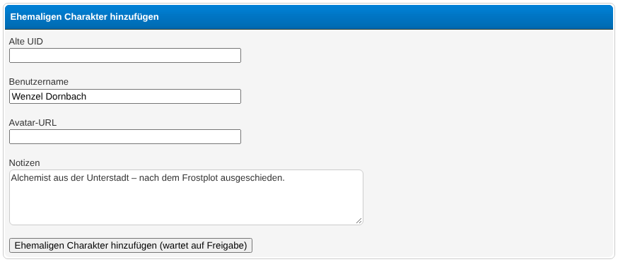
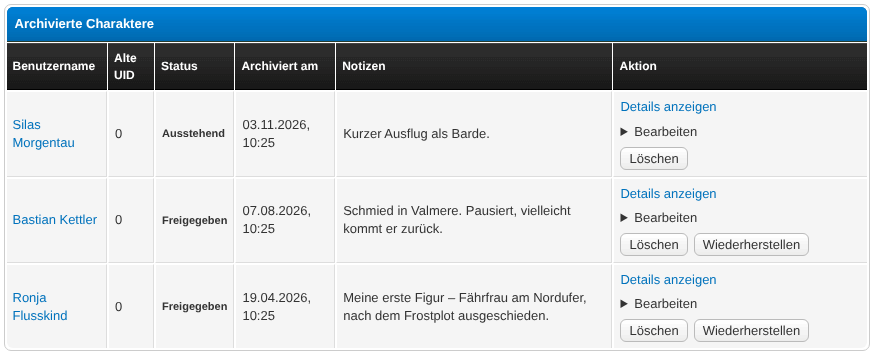
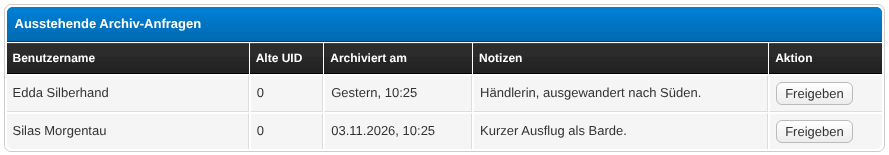
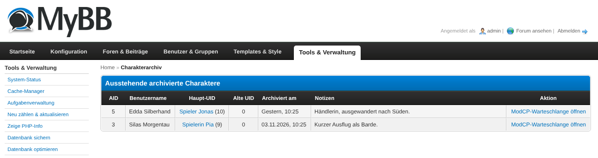

# Character Archive

A MyBB 1.8 plugin that archives former RPG sub-characters when they are deleted, supports manual entries, a moderator approval workflow, and full character recovery.

## Requirements

- MyBB 1.8.x
- PHP 7.4 or higher (tested up to PHP 8.x)
- No required dependencies
- Optional: [MyAlerts](https://community.mybb.com/thread-171024.html) – for in-forum notifications
- Optional: [application_ucp](https://github.com/katjalennartz/application_ucp) by katjalennartz – character sheet data is captured automatically when a character is archived

## Installation

1. **Upload files** – copy all files to your MyBB root directory, preserving the folder structure:
   - `inc/plugins/char_archive.php`
   - `inc/char_archive_ucp.php`
   - `inc/char_archive_modcp.php`
   - `admin/modules/tools/char_archive.php`
   - `inc/languages/english/char_archive.lang.php`
   - `inc/languages/english/admin/char_archive.lang.php`
   - `inc/languages/deutsch_du/char_archive.lang.php`
   - `inc/languages/deutsch_du/admin/char_archive.lang.php`

2. **Install & Activate** – go to ACP → Configuration → Plugins → click **Install & Activate** next to **Character Archive**.
   The archive table `rpg_char_archive` and plugin settings are created automatically.

3. **Configure** – go to ACP → Configuration → Settings → **Character Archive** and adjust the settings.

## Configuration

| Setting | Description |
|---|---|
| **Groups allowed to approve archive entries** | User groups that can see pending archive requests in the ModCP and approve them. Default: groups 3, 4, 6. |
| **Archived playerstat text: profile field** | Choose a field from [application_ucp](https://github.com/katjalennartz/application_ucp) whose content is shown below the stats of archived characters in the Spielerverzeichnis playerstat block. Falls back to the archive entry's notes field if empty. Only visible if `application_ucp` is installed. |
| **Debug mode** | Writes a detailed debug log (PHP error log and `cache/char_archive_debug.log`). Only for troubleshooting – turn it off again afterwards and delete the log file. Default: off. |
| **Debug: verbose field ID** | Additional field-level detail in the debug log. Default: off. |

## Usage

### First steps after activation

1. Activate the plugin.
2. Set the approver groups in ACP → Configuration → Settings → Character Archive.
3. If you use [application_ucp](https://github.com/katjalennartz/application_ucp), select the character sheet field to display in the playerstat block (ACP → Configuration → Settings → Character Archive).
4. Inform your players that they can manage their former characters in UserCP.

### Automatic archiving on account deletion

When a sub-character account is deleted (by an admin or via self-delete), the plugin automatically creates an archive entry containing:

- Username, old UID, registration date, post count, thread count
- Avatar URL and dimensions
- Serialised profile fields
- Serialised `application_ucp` data (if present)
- Archiving timestamp

No manual action is required. A MyAlerts notification is sent to the main account (if MyAlerts is installed).

### UserCP – managing former characters

Players access their archive via **UserCP → Archived Characters**.

**View list:**
The page shows all archived characters belonging to the logged-in user with status (Pending / Approved) and the archiving date.

**Add a former character manually:**
1. UserCP → Archived Characters → click **Add Former Character (pending approval)**
2. Fill in the character's username. Old UID and notes are optional.
3. Submit – the entry is created with status **Pending**.

**View details:**
Click **View details** next to any entry to see:
- General data (old UID, registration date, posts, threads)
- Archived profile fields
- Archived `application_ucp` fields
- Links to the old logbook and relations page (if old UID is set)

**Edit / delete an entry:**
- Entries with status **Pending** can be edited or withdrawn by the player.
- Entries with status **Approved** or **Recovered** are locked for the player.

**Recover an approved character (player-side):**
1. UserCP → Archived Characters → find an approved entry
2. Click **Recover** and confirm
3. A new account is created. The temporary password or a notice that the main account password was reused is shown.

### ModCP – approving pending entries

Users in the configured approver groups see a **Pending Archive Requests** link in the ModCP navigation.

1. ModCP → Pending Archive Requests
2. Review the entry (username, old UID, notes, archiving date)
3. Click **Approve** to set the entry to status **Approved**

The player receives a MyAlerts notification (if installed) when their entry is approved.

### ACP Tools – recovery

Go to **ACP → Tools → Character Archive**.

**Recovery (admin-side):**
1. In the entry list, click **Recover** next to an approved entry
2. Confirm on the confirmation page
3. A new MyBB user is created with the archived username
4. Posts and threads are remapped to the new UID
5. Logbook entries (if table `mybb_logbook` exists) are remapped
6. The archive entry is marked as recovered; the temporary password is displayed

The main account receives a MyAlerts notification and an email (if configured).

### Integration with Spielerverzeichnis / Playerdirectory

See [`docs/playerdirectory-integration.md`](docs/playerdirectory-integration.md) for a step-by-step guide.

Public helpers available to external plugins:
- `char_archive_get_archived_characters_for_main($main_uid, $options = [])`
- `char_archive_get_archived_totals_for_main($main_uid, $options = [])`

### Tips & Tricks

- **Pending alert on the forum index:** The plugin injects a notice on the forum index for approver groups when there are pending entries. No configuration needed.
- **Deleted accounts without a main UID:** If a deleted account has no linked main account, the archive entry is created with `main_uid = 0`. It still appears in the admin tool.
- **application_ucp data:** If [application_ucp](https://github.com/katjalennartz/application_ucp) is installed, the character sheet is captured automatically at archiving time. No additional sync step is needed.

## Screenshots

## Uninstallation

1. Go to ACP → Configuration → Plugins → deactivate **Character Archive**.
2. Click **Uninstall** (or deactivate then uninstall if your MyBB version shows a separate button).

**What is removed on uninstall:**
- Database table `rpg_char_archive` (all archive data is permanently deleted)
- Plugin settings and settings group
- Installed templates
- UserCP nav link, ModCP nav link, and index alert placeholder

**What is NOT removed:**
- The plugin files themselves – delete them manually from the server after uninstalling.

## Changelog

### 0.2
- ModCP approval queue
- Pending alert on forum index for approver groups
- `application_ucp` snapshot on deletion and manual entries
- Playerdirectory integration hooks
- UserCP detail view with profile fields and UCP fields
- Player-side recovery

### 0.1
- Initial release: automatic archiving on account deletion, UserCP list, ACP Tools sync and recovery
